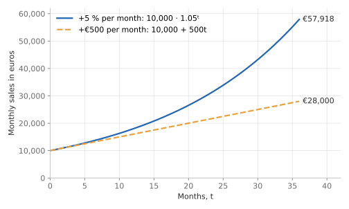

# Exponential functions and logarithms {#sec-exp-log}

::: {.goals}
Goals

- Model growth and decline by a fixed percentage with an exponential function.
- Explain why exponential growth overtakes linear growth.
- Use the logarithm to answer "how long until…?" questions.
- Estimate doubling times with the rule of 70.
:::

::: {.video minutes="14"}
Exponential growth and logarithms
:::

## Growth by a fixed percentage

Linear growth adds the **same amount** in every period. Exponential growth multiplies by the **same factor** in every period. In Session 1 you met the growth factor $1 + p$; an **exponential function** applies it $t$ times:

$$f(t) = a \cdot (1 + p)^t$$

Here $a$ is the starting value ($f(0) = a$), $p$ the growth rate per period and $t$ the number of periods. Unlike in a power function, the input $t$ sits **in the exponent**.

::: {.callout-note}
## Worked example: two growth plans
Loop Cycles' online shop sells €10,000 a month. Two forecasts for the next three years:

- **Linear:** sales grow by €500 a month, $L(t) = 10\,000 + 500\,t$.
- **Exponential:** sales grow by 5 % a month, $E(t) = 10\,000 \cdot 1.05^t$.

After 12 months the two are still close: $L(12) = 16\,000$ and $E(12) \approx 17\,959$. After 36 months they are far apart: $L(36) = 28\,000$ but $E(36) \approx 57\,918$.
:::

{#fig-exp-vs-linear fig-alt="Two curves starting at 10,000 euros. The dashed straight line rises steadily to 28,000 euros after 36 months. The solid curve rises slowly at first and then ever more steeply, reaching 57,918 euros after 36 months."}

@fig-exp-vs-linear shows why exponential growth is so often underestimated: at the start it looks harmless, and by the time the difference is obvious it is large. The same mathematics describes compound interest, inflation, user numbers of a new app and, unfortunately, debt that is not paid back.

### Decline by a fixed percentage

If $p$ is negative, the function falls. A delivery van bought for €20,000 that loses 20 % of its value every year is worth

$$
\begin{aligned}
V(t) &= 20\,000 \cdot 0.8^t\\
V(3) &= 20\,000 \cdot 0.512 = 10\,240
\end{aligned}
$$

After three years, the van is worth €10,240.

The value never quite reaches zero; it just keeps shrinking by a fifth. You will meet this again in Session 4 as declining-balance depreciation.

## How long until…? The logarithm

Questions about time put the unknown in the exponent: "When will sales have doubled?" means

$$10\,000 \cdot 1.05^t = 20\,000 \quad\Longleftrightarrow\quad 1.05^t = 2$$

You cannot solve this with a root, because the unknown is the exponent, not the base. The tool for this is the **logarithm**: it answers the question "to which power must I raise the base to get this number?"

$$\log_b(x) = y \quad\Longleftrightarrow\quad b^y = x$$

For example, $\log_{10}(1000) = 3$ because $10^3 = 1000$, and $\log_2(8) = 3$ because $2^3 = 8$.

On calculators and in software you mostly use the **natural logarithm** $\ln$, the logarithm to the base $e \approx 2.718$. You do not need to know where $e$ comes from for this course. What you need is one rule:

$$\ln\!\left(a^t\right) = t \cdot \ln(a)$$

The logarithm brings the exponent down to where you can reach it.

::: {.callout-note}
## Worked example: doubling time
Solve $1.05^t = 2$. Take the logarithm on both sides and bring the exponent down:

$$
\begin{aligned}
\ln\!\left(1.05^t\right) &= \ln(2)\\
t \cdot \ln(1.05) &= \ln(2)\\
t &= \frac{\ln(2)}{\ln(1.05)} = \frac{0.6931}{0.04879} \approx 14.2
\end{aligned}
$$

At 5 % a month, sales double in a little over **14 months**.
:::

In general, an amount that grows from $K_0$ to $K_n$ at the rate $i$ per period needs

$$n = \frac{\ln\!\left(K_n / K_0\right)}{\ln(1 + i)} \text{ periods.}$$

This completes the set from @sec-rearranging: the compound growth formula can now be solved for every one of its letters.

::: {.callout-note}
## Worked example: saving for new equipment
Loop Cycles puts €10,000 into a savings account at 4 % a year. How long until it has €15,000 for a new paint booth?

$$
\begin{aligned}
n &= \frac{\ln(15\,000 / 10\,000)}{\ln(1.04)} = \frac{\ln(1.5)}{\ln(1.04)}\\
&\approx \frac{0.4055}{0.0392} \approx 10.3
\end{aligned}
$$

After 10 years it is not quite there, so it takes **11 years**. (Interest is usually paid once a year, so round up to a whole year.)
:::

::: {.callout-warning}
## Common mistake: logarithm rules that do not exist
$\ln(a + b)$ is **not** $\ln(a) + \ln(b)$, and $\frac{\ln(2)}{\ln(1.05)}$ is **not** $\ln\!\left(\frac{2}{1.05}\right)$. The rules that do hold are:

$$
\begin{aligned}
\ln(a \cdot b) &= \ln(a) + \ln(b)\\
\ln\!\left(\frac{a}{b}\right) &= \ln(a) - \ln(b)\\
\ln\!\left(a^t\right) &= t \cdot \ln(a)
\end{aligned}
$$
:::

## The rule of 70

For quick estimates there is a shortcut: something that grows by $r$ percent per period doubles after roughly

$$\text{doubling time} \approx \frac{70}{r}$$

periods. At 5 % a month: $\frac{70}{5} = 14$ months (exact: 14.2). At 2 % inflation a year, prices double in about $\frac{70}{2} = 35$ years (exact: 35.0). The rule works well for rates up to about 10 %. You will also see it as the "rule of 72", which gives similar results.

::: {.voice}
The rule of 70 is one of the few formulas I use in everyday conversation. When someone tells me a price, a city or a follower count is "growing 7 % a year", I hear "doubles in ten years", and that is usually the more useful way to think about it.
:::

## In a spreadsheet, R and Python

::: {.callout-warning}
## Common mistake: `LOG` in a spreadsheet is base 10
In Excel, LibreOffice and Google Sheets, `LN()` is the natural logarithm and `LOG()` uses base 10. For doubling times it does not matter which you use, as long as you use the **same one above and below the fraction bar**: `=LOG(2)/LOG(1.05)` and `=LN(2)/LN(1.05)` both give 14.2. In R and Python, `log()` is the natural logarithm.
:::

```{.sheet title="Doubling time and saving time with LN" highlight="B2 B5"}
Growth rate per period | 5%
Doubling time | =LN(2)/LN(1+B1) -> 14.21
Start value | 10000
Target value | 15000
Years at 4 % | =LN(B4/B3)/LN(1.04) -> 10.34
```

::: {.panel-tabset group="language"}
## R
```r
log(2) / log(1.05)              # 14.2067
log(15000 / 10000) / log(1.04)  # 10.33804
10000 * 1.05^(0:3)              # 10000.00 10500.00 11025.00 11576.25
```
## Python
```python
import math
math.log(2) / math.log(1.05)              # 14.206699082890461
math.log(15000 / 10000) / math.log(1.04)  # 10.338035071507665
[10000 * 1.05**t for t in range(4)]       # [10000.0, 10500.0, 11025.0, 11576.250000000002]
```
:::

::: {.callout-tip}
## Check yourself

1. A town of 50,000 people grows by 2 % a year. Write the population as a function of time and calculate it after 10 years.

   ::: {.hidden-solution}
   $N(t) = 50\,000 \cdot 1.02^t$, $N(10) = 50\,000 \cdot 1.21899 \approx 60\,950$.
   :::

2. Calculate $\log_{10}(100\,000)$ and $\log_2(32)$ without a calculator.

   ::: {.hidden-solution}
   $10^5 = 100\,000$, so 5. $2^5 = 32$, so 5.
   :::

3. How long does it take an investment to double at 6 % a year? Compare with the rule of 70.

   ::: {.hidden-solution}
   $\frac{\ln 2}{\ln 1.06} \approx \frac{0.6931}{0.05827} \approx 11.9$ years. Rule of 70: $\frac{70}{6} \approx 11.7$ years.
   :::

4. The delivery van loses 20 % of its value per year. After how many years is it worth less than half its price?

   ::: {.hidden-solution}
   $0.8^t = 0.5$, so $t = \frac{\ln 0.5}{\ln 0.8} \approx \frac{-0.6931}{-0.2231} \approx 3.1$. After **4 years** (after 3 years it is still worth 51.2 %).
   :::
:::
