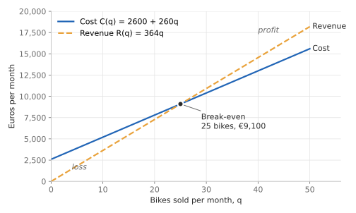

# What a function is {#sec-functions}

::: {.goals}
Goals

- Explain a function as input, rule and output.
- Read and write function notation such as $C(q)$.
- Describe the same function by formula, table and graph.
- Tell evaluating a function from solving an equation.
:::

::: {.video minutes="11"}
What a function is: formula, table and graph
:::

## Input, rule, output

A **function** is a rule that gives exactly **one output for every input**. Loop Cycles' monthly cost is a function of the number of bikes it refurbishes: tell me the number of bikes, and I can tell you the cost.

$$C(q) = 2600 + 260\,q$$

Read it as "C of q equals…". The letters have fixed roles:

| Part | Here | Meaning |
|-------------------|:----------:|------------------------------------------|
| Name of the function | $C$     | Cost |
| Input (argument)  | $q$        | Bikes per month |
| Rule              | $2600 + 260\,q$ | What to do with the input |
| Output (value)    | $C(q)$     | Cost in euros per month |

**Evaluating** a function means putting in a value: $C(30) = 2600 + 260 \cdot 30 = 10\,400$. Thirty bikes cost €10,400 a month.

::: {.callout-warning}
## Common mistake: $C(q)$ is not "C times q"
The brackets in $C(30)$ mean "the function $C$ at the input 30", not multiplication. That is why we write $C(q)$ and not $C \cdot q$.
:::

## Three ways to describe a function

The same function can be shown as a formula, a table or a graph. Each has its strengths.

**Formula.** Short and exact; it works for any input: $C(q) = 2600 + 260\,q$.

**Table.** Easy to read off a few values. This is what a spreadsheet shows you.

| Bikes $q$ | 0 | 10 | 20 | 30 | 40 | 50 |
|-----------|---:|---:|---:|---:|---:|---:|
| Cost $C(q)$ | 2,600 | 5,200 | 7,800 | 10,400 | 13,000 | 15,600 |

**Graph.** Shows the shape at a glance: whether costs rise steadily, where two functions meet, where a maximum lies. The input goes on the horizontal axis, the output on the vertical axis.

{#fig-cost-revenue fig-alt="Two straight lines. The cost line starts at 2,600 euros and rises gently; the revenue line starts at zero and rises more steeply. They cross at 25 bikes and 9,100 euros. Left of the crossing is labelled loss, right of it profit."}

@fig-cost-revenue tells a whole story without a single calculation: at zero bikes there is still €2,600 of cost; revenue rises faster than cost; the lines cross at 25 bikes; to the right of that, the gap between them is profit.

## Which inputs make sense?

Mathematically, you can put any number into $C(q) = 2600 + 260\,q$, including $-5$ or $3.7$. In business, only some inputs make sense: Loop Cycles cannot sell $-5$ bikes, and the workshop cannot refurbish more than about 50 bikes a month. The set of sensible inputs is the **domain**. Here: $q = 0, 1, 2, \dots, 50$.

We still draw the graph as a continuous line, because it is easier to read. Just remember that only whole numbers of bikes are real.

## Evaluating versus solving

Session 2 and this session use the same formulas, but ask opposite questions:

| Question | Type | Calculation |
|-------------------------------------------|:-----------:|-------------------------------|
| What does it cost to make 30 bikes?       | Evaluate    | $C(30) = 10\,400$ |
| How many bikes can we make for €10,400?   | Solve       | $2600 + 260\,q = 10\,400 \Rightarrow q = 30$ |

Evaluating goes from input to output and is always easy. Solving goes from output back to input; that is what Session 2 was about.

## Functions in business

Almost every business quantity is a function of something else:

| Function | Input | Output |
|----------------------------|------------------|-------------------------------|
| Cost function $C(q)$       | Quantity          | Total cost |
| Revenue function $R(q)$    | Quantity          | Revenue |
| Profit function $P(q)$     | Quantity          | Profit, $P(q) = R(q) - C(q)$ |
| Demand function $q(p)$     | Price             | Quantity customers buy |
| Sales over time $S(t)$     | Time              | Sales in period $t$ |
| Shipping cost              | Weight            | Price of a parcel |

::: {.voice}
If you take one idea away from this session, make it this one: a spreadsheet formula that you fill down a column *is* a function. The column of inputs is the table's top row, the formula is the rule, and the results are the outputs. You will see this in @sec-s3-business, and my IT colleagues will build on it for the rest of the module.
:::

::: {.callout-tip}
## Check yourself

1. For $R(q) = 364\,q$, calculate $R(10)$ and $R(25)$.

   ::: {.hidden-solution}
   $R(10) = 3640$ and $R(25) = 9100$ euros.
   :::

2. Use @fig-cost-revenue: roughly how much profit does Loop Cycles make at 40 bikes?

   ::: {.hidden-solution}
   Revenue about €14,600, cost about €13,000, so a profit of about €1,600. Exactly: $104 \cdot 40 - 2600 = 1560$.
   :::

3. A parcel service charges €5 plus €1.20 per kilogram. Write this as a function and evaluate it for 4 kg.

   ::: {.hidden-solution}
   $S(w) = 5 + 1.20\,w$, so $S(4) = 5 + 4.80 = 9.80$ euros.
   :::

4. Is "the price of each product in a shop" a function of the product? Is "the product" a function of the price?

   ::: {.hidden-solution}
   Product → price is a function: each product has one price. Price → product is not: several products can have the same price, so one input would have several outputs.
   :::
:::
