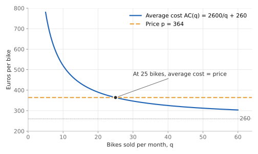

# Linear functions {#sec-linear-functions}

::: {.goals}
Goals

- Recognise a linear function and name its slope and intercept.
- Interpret slope and intercept in business terms (variable cost, fixed cost, price).
- Find a linear function from two data points.
- Use linear functions for cost, revenue, profit, average cost and market equilibrium.
:::

::: {.video minutes="12"}
Linear functions: slope and intercept
:::

## Slope and intercept

A **linear function** has the form

$$f(x) = m\,x + b$$

Its graph is a straight line. The two numbers $m$ and $b$ tell you everything about it:

- The **intercept** $b$ is the value at $x = 0$: where the line crosses the vertical axis.
- The **slope** $m$ is how much the output changes when the input rises by 1. A positive slope means the line rises; a negative slope means it falls.

In Loop Cycles' cost function $C(q) = 2600 + 260\,q$, the intercept is the **fixed cost** (€2,600, the cost at zero bikes) and the slope is the **variable cost per unit** (€260 for each extra bike). In the revenue function $R(q) = 364\,q$, the intercept is 0 and the slope is the **price**.

::: {.callout-note appearance="simple"}
## Slope means "per"
Whenever you see the word *per* in a business description (per unit, per hour, per kilogram, per month), you are looking at a slope. The fixed part, the part that does not depend on the input, is the intercept.
:::

## A line from two points

Often you do not get the formula, only two observations. From two points $(x_1, y_1)$ and $(x_2, y_2)$:

$$
\begin{aligned}
m &= \frac{y_2 - y_1}{x_2 - x_1} = \frac{\text{change in output}}{\text{change in input}}\\
b &= y_1 - m\,x_1
\end{aligned}
$$

::: {.callout-note}
## Worked example: an electricity bill
Loop Cycles' workshop used 100 kWh of electricity in March and paid €45; in April it used 300 kWh and paid €105. Assuming a linear tariff:

$$m = \frac{105 - 45}{300 - 100} = \frac{60}{200} = 0.30 \text{ euros per kWh}$$
$$b = 45 - 0.30 \cdot 100 = 15 \text{ euros}$$

The tariff is $E(k) = 15 + 0.30\,k$: a fixed monthly charge of €15 plus 30 cents per kWh. Check with April: $15 + 0.30 \cdot 300 = 105$. ✓
:::

## Cost, revenue and profit

For Loop Cycles (fixed costs €2,600, variable cost €260, price €364):

$$
\begin{aligned}
C(q) &= 2600 + 260\,q\\
R(q) &= 364\,q\\
P(q) &= R(q) - C(q) = 104\,q - 2600
\end{aligned}
$$

The profit function is linear too. Its slope, 104, is the **contribution margin** from Session 2; its intercept, $-2600$, is the loss at zero sales: exactly the fixed costs.

## Average cost: why size helps

The **average cost** per bike is the total cost divided by the number of bikes:

$$AC(q) = \frac{C(q)}{q} = \frac{2600 + 260\,q}{q} = \frac{2600}{q} + 260$$

This is not a linear function: the fixed costs are spread over more and more bikes, so the average cost falls, quickly at first and then more slowly, towards €260. This is the simplest form of **economies of scale**.

{#fig-average-cost fig-alt="A curve that falls steeply from about 780 euros at 5 bikes and flattens out above 260 euros. A dashed horizontal line at 364 euros marks the price; curve and line meet at 25 bikes."}

Where the average cost equals the price (@fig-average-cost), Loop Cycles breaks even: at 25 bikes again. Every route leads to the same answer.

## Supply, demand and equilibrium

Linear functions also describe markets. A **demand function** shows how much customers want to buy at each price; it falls, because higher prices put buyers off. A **supply function** shows how much sellers offer; it rises, because higher prices attract sellers. Economists usually write both with the price on the left:

::: {.callout-note}
## Worked example: market equilibrium
In a city's market for used e-bikes, demand and supply are (price $p$ in euros, quantity $q$ in bikes per month):

$$
\begin{aligned}
\text{Demand: } p &= 500 - 2q\\
\text{Supply: } p &= 200 + q
\end{aligned}
$$

The market is in **equilibrium** where buyers and sellers agree on price and quantity, so where both give the same $p$:

$$
\begin{aligned}
500 - 2q &= 200 + q &&\mid +2q,\ -200\\
300 &= 3q\\
q &= 100
\end{aligned}
$$

Equilibrium quantity: 100 bikes per month. Equilibrium price: $p = 200 + 100 = 300$ euros. Check with demand: $500 - 2 \cdot 100 = 300$. ✓
:::

::: {.callout-tip}
## Check yourself

1. A taxi charges €4.50 plus €2.10 per kilometre. Name slope and intercept, and calculate the fare for 12 km.

   ::: {.hidden-solution}
   Intercept 4.50 (fixed charge), slope 2.10 (per km). Fare: $4.50 + 2.10 \cdot 12 = 29.70$ euros.
   :::

2. Producing 200 units costs €5,000 and producing 500 units costs €8,000. Find the linear cost function. What are the fixed costs?

   ::: {.hidden-solution}
   $m = \frac{8000 - 5000}{500 - 200} = 10$, $b = 5000 - 10 \cdot 200 = 3000$. $C(q) = 3000 + 10\,q$; fixed costs €3,000.
   :::

3. For the cost function in question 2, what is the average cost at 100 units and at 1,000 units?

   ::: {.hidden-solution}
   $AC(100) = \frac{3000}{100} + 10 = 40$; $AC(1000) = 3 + 10 = 13$ euros per unit.
   :::

4. Demand is $p = 80 - 0.5q$ and supply is $p = 20 + q$. Find the equilibrium.

   ::: {.hidden-solution}
   $80 - 0.5q = 20 + q$, so $60 = 1.5q$ and $q = 40$; $p = 60$.
   :::
:::
