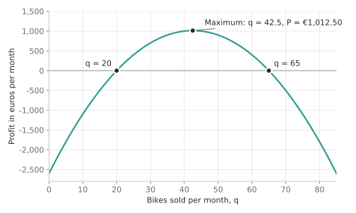

# Power and quadratic functions {#sec-power-quadratic}

::: {.goals}
Goals

- Recognise power functions and describe their shapes.
- Interpret diminishing returns and economies of scale.
- Find the vertex of a parabola and use it to find the maximum profit.
- Explain why maximum revenue and maximum profit are not the same.
:::

::: {.video minutes="13"}
Quadratic functions and the maximum profit
:::

## Power functions

A **power function** has the form $f(x) = a \cdot x^k$: the input is raised to a fixed power $k$. The exponent decides the shape (for $x > 0$ and $a > 0$):

| Exponent | Example | Shape | In business |
|:--------------:|------------------|--------------------------------------|----------------------------------|
| $k > 1$        | $x^2$, $x^3$     | Rises faster and faster              | Costs that explode near capacity |
| $k = 1$        | $x$              | Straight line                        | Constant cost per unit |
| $0 < k < 1$    | $\sqrt{x} = x^{0.5}$ | Rises more and more slowly       | Diminishing returns |
| $k < 0$        | $\frac{1}{x} = x^{-1}$ | Falls, flattening out          | Fixed cost per unit, $\frac{F}{q}$ |

The average cost $\frac{2600}{q} + 260$ from @sec-linear-functions contains the power function $2600 \cdot q^{-1}$.

::: {.callout-note}
## Worked example: diminishing returns
A small workshop's monthly output (in repaired bikes) depends on the hours worked $L$ roughly as $Q(L) = 20\sqrt{L}$.

- 100 hours: $Q(100) = 20 \cdot 10 = 200$ repairs.
- 400 hours: $Q(400) = 20 \cdot 20 = 400$ repairs.

Four times the hours only doubles the output. Each extra hour adds a little less than the one before, for example because the workshop gets crowded and tools have to be shared. Economists call this **diminishing returns**.
:::

## Quadratic functions and parabolas

A **quadratic function** has the form

$$f(x) = a\,x^2 + b\,x + c, \qquad a \neq 0$$

Its graph is a **parabola**. If $a > 0$ it opens upwards (a valley); if $a < 0$ it opens downwards (a hill). The highest or lowest point is the **vertex**, at

$$x_{\text{vertex}} = -\frac{b}{2a}$$

The parabola is symmetric around the vertex. That gives a quick check: if the function has two zeros, the vertex lies exactly halfway between them.

## The best volume for Loop Cycles

In Session 2, Loop Cycles found that it can sell more bikes only at a lower price, $p(q) = 430 - 2q$. Its profit function was

$$P(q) = -2q^2 + 170q - 2600$$

with break-even points at 20 and 65 bikes. Now we can find the **maximum profit**:

$$q_{\text{vertex}} = -\frac{170}{2 \cdot (-2)} = \frac{170}{4} = 42.5$$

Check with symmetry: halfway between 20 and 65 is $\frac{20 + 65}{2} = 42.5$. ✓

$$
\begin{aligned}
P(42.5) &= -2 \cdot 42.5^2 + 170 \cdot 42.5 - 2600\\
&= -3612.5 + 7225 - 2600 = 1012.50
\end{aligned}
$$

{#fig-profit-parabola fig-alt="A downward-opening parabola. It crosses zero at 20 and 65 bikes and peaks at 42.5 bikes with a profit of 1,012.50 euros. At zero bikes the profit is minus 2,600 euros."}

Loop Cycles cannot sell half a bike, so it compares 42 and 43 bikes: $P(42) = P(43) = 1012$ euros. Either volume is best, at a price of about $430 - 2 \cdot 42.5 = 345$ euros. This is the €1,012.50 that Session 2 called "the best Loop Cycles can do in this model".

::: {.callout-note}
## Worked example: maximum revenue is not maximum profit
Revenue in the same model is $R(q) = q \cdot p(q) = 430q - 2q^2$. Its vertex is at $q = -\frac{430}{2 \cdot (-2)} = 107.5$ bikes, with revenue of €23,112.50 at a price of €215.

But at €215, every bike sells below its cost of €260. The revenue would be impressive and the business would lose money on every sale. **Maximising revenue and maximising profit are different goals**, and only one of them pays the rent.
:::

::: {.voice}
I see the revenue-versus-profit confusion more often than you would think, and not only among students. "We grew sales by 30 %!" is a great headline. Whether it was a good year is a different question.
:::

::: {.callout-tip}
## Check yourself

1. Find the vertex of $f(x) = x^2 - 8x + 3$. Is it a maximum or a minimum?

   ::: {.hidden-solution}
   $x = -\frac{-8}{2 \cdot 1} = 4$, $f(4) = 16 - 32 + 3 = -13$. Since $a = 1 > 0$ the parabola opens upwards: a minimum at $(4, -13)$.
   :::

2. A profit function is $P(q) = -q^2 + 60q - 500$. At which volume is profit highest, and how high is it?

   ::: {.hidden-solution}
   $q = -\frac{60}{2 \cdot (-1)} = 30$, $P(30) = -900 + 1800 - 500 = 400$.
   :::

3. With $Q(L) = 20\sqrt{L}$, how many hours are needed for 300 repairs?

   ::: {.hidden-solution}
   $20\sqrt{L} = 300$, so $\sqrt{L} = 15$ and $L = 225$ hours.
   :::

4. Demand is $p(q) = 100 - 0.5q$. At which quantity is revenue highest?

   ::: {.hidden-solution}
   $R(q) = 100q - 0.5q^2$, vertex at $q = -\frac{100}{2 \cdot (-0.5)} = 100$, with price $p = 50$ and revenue $5000$.
   :::
:::
