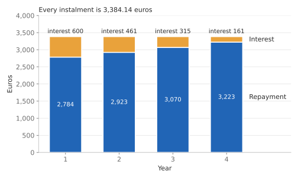

# Savings plans and loans {#sec-annuities}

::: {.goals}
Goals

- Add up a geometric series with one formula.
- Calculate the final value of a savings plan and the present value of regular payments.
- Calculate the equal instalment of a loan.
- Write a repayment schedule and find the remaining debt at any time.
:::

::: {.video minutes="15"}
Savings plans and loans: the annuity formula
:::

## Regular payments

Most money over time does not come as one payment. You save €100 every month, a lease costs €3,200 every year, a loan is repaid in equal instalments. A series of equal payments at regular intervals is called an **annuity** in English. In German, *Annuität* usually means the equal yearly instalment of a loan; the mathematics is the same.

In this chapter, payments are made at the **end** of each period, which is the standard case for loans and most savings plans.

## The geometric series

Suppose you pay €1,000 into a savings account at the end of each year for 5 years, at 3 %. The first payment earns interest for 4 years, the second for 3, and so on; the last payment earns nothing. The final value is

$$
\begin{aligned}
&1\,000 \cdot 1.03^4 + 1\,000 \cdot 1.03^3 + 1\,000 \cdot 1.03^2\\
&{}+ 1\,000 \cdot 1.03 + 1\,000
\end{aligned}
$$

You could add five terms by hand, but not 360 for a 30-year monthly plan. Sums of this kind, where each term is the previous one times the same factor $q$, are called **geometric series**, and they have a closed formula:

$$1 + q + q^2 + \dots + q^{n-1} = \frac{q^n - 1}{q - 1} \qquad (q \neq 1)$$

::: {.callout-note collapse="true"}
## Why the formula works (optional)
Call the sum $S$. Multiply it by $q$, and almost every term reappears, shifted by one:

$$
\begin{aligned}
S &= 1 + q + q^2 + \dots + q^{n-1}\\
q \cdot S &= \phantom{1 + {}} q + q^2 + \dots + q^{n-1} + q^n
\end{aligned}
$$

Subtract the first line from the second. Everything cancels except $q^n$ and $1$:

$$q \cdot S - S = q^n - 1 \quad\Longrightarrow\quad S = \frac{q^n - 1}{q - 1}$$
:::

## Savings plans: the final value

With a payment $R$ at the end of each period, the final value after $n$ periods is the geometric series times $R$:

$$R_n = R \cdot \frac{q^n - 1}{q - 1} = R \cdot \frac{q^n - 1}{i}$$

::: {.callout-note}
## Worked example: saving for the paint booth
Loop Cycles saves €1,000 at the end of each year for 5 years at 3 %.

$$
\begin{aligned}
R_5 &= 1\,000 \cdot \frac{1.03^5 - 1}{0.03} = 1\,000 \cdot \frac{0.159274}{0.03}\\
&\approx 5\,309.14 \text{ euros}
\end{aligned}
$$

It paid in €5,000; the other €309.14 is interest.
:::

## Regular payments: the present value

What are regular payments worth **today**? Discount the final value by $q^n$:

$$R_0 = \frac{R_n}{q^n} = R \cdot \frac{q^n - 1}{q^n \cdot (q - 1)} = R \cdot \frac{1 - q^{-n}}{i}$$

The fraction is called the **present value factor** of an annuity (*Rentenbarwertfaktor*).

::: {.callout-note}
## Worked example: what is a lease worth?
A leasing company offers the workshop equipment for €3,200 at the end of each year for 4 years. At 5 %,

$$
\begin{aligned}
R_0 &= 3\,200 \cdot \frac{1 - 1.05^{-4}}{0.05} = 3\,200 \cdot 3.545951\\
&\approx 11\,347.04 \text{ euros}
\end{aligned}
$$

The lease payments add up to €12,800, but in today's money they cost €11,347.04. You will compare this with buying in @sec-s4-business.
:::

## Loans repaid in equal instalments

Most business and consumer loans are **annuity loans** (*Annuitätendarlehen*): you pay the same amount $A$ every period, and each instalment covers that period's interest plus a part of the debt. The instalment is chosen so that the present value of all instalments equals the loan $K_0$. Solve the present value formula for $R$, and you get the **annuity formula**:

$$A = K_0 \cdot \frac{q^n \cdot (q - 1)}{q^n - 1} = K_0 \cdot \frac{i \cdot q^n}{q^n - 1}$$

::: {.callout-note}
## Worked example: the instalment of a loan
Loop Cycles borrows €12,000 for the workshop equipment at 5 % a year, repaid in 4 yearly instalments.

$$
\begin{aligned}
A &= 12\,000 \cdot \frac{0.05 \cdot 1.05^4}{1.05^4 - 1}\\
&= 12\,000 \cdot \frac{0.05 \cdot 1.215506}{0.215506}\\
&\approx 3\,384.14 \text{ euros a year}
\end{aligned}
$$

Over the four years it pays $4 \cdot 3\,384.14 = 13\,536.57$ euros, so the loan costs €1,536.57 in interest.
:::

### The repayment schedule

A **repayment schedule** (*Tilgungsplan*) shows, period by period, how each instalment splits into interest and repayment (*Tilgung*). Each row follows the same three steps:

1. Interest = balance at the start × $i$
2. Repayment = instalment − interest
3. Balance at the end = balance at the start − repayment

| Year | Balance at start | Interest | Repayment | Instalment | Balance at end |
|:----:|-----:|-----:|-----:|-----:|-----:|
| 1 | 12,000.00 | 600.00 | 2,784.14 | 3,384.14 | 9,215.86 |
| 2 | 9,215.86 | 460.79 | 2,923.35 | 3,384.14 | 6,292.51 |
| 3 | 6,292.51 | 314.63 | 3,069.52 | 3,384.14 | 3,222.99 |
| 4 | 3,222.99 | 161.15 | 3,222.99 | 3,384.14 | 0.00 |
| **Total** | | **1,536.57** | **12,000.00** | **13,536.57** | |

: Repayment schedule for €12,000 at 5 % over 4 years {#tbl-schedule}

{#fig-loan-split fig-alt="Four bars of equal height, 3,384 euros each, one per year. The lower, blue part is repayment and rises from 2,784 to 3,223 euros. The upper, amber part is interest and falls from 600 to 161 euros."}

::: {.callout-warning}
## Common mistake: interest on the original loan
Interest is calculated on the **remaining** balance, not on the original €12,000 every year. That is why the interest falls from €600 to €161, and why the total interest is €1,536.57, not $4 \cdot 600 = 2\,400$ euros.
:::

### The remaining debt

How much does Loop Cycles still owe after 2 years? You could work through the schedule, or use one formula: the loan grows with compound interest, and the instalments paid so far grow like a savings plan. The remaining debt after $k$ periods is the difference:

$$K_k = K_0 \cdot q^k - A \cdot \frac{q^k - 1}{q - 1}$$

$$
\begin{aligned}
K_2 &= 12\,000 \cdot 1.05^2 - 3\,384.14 \cdot \frac{1.05^2 - 1}{0.05}\\
&= 13\,230 - 6\,937.49 = 6\,292.51 \text{ euros}
\end{aligned}
$$

This matches the schedule. The formula is useful when a long loan is paid off early or refinanced: the bank wants the remaining debt.

### Monthly instalments

Many loans are paid monthly. Use the monthly rate $\frac{i}{12}$ and the number of months, as in @sec-interest.

::: {.callout-note}
## Worked example: the same loan, paid monthly
€12,000 at a nominal 6 % a year, repaid in 36 monthly instalments. The monthly rate is $\frac{0.06}{12} = 0.005$.

$$
\begin{aligned}
A &= 12\,000 \cdot \frac{0.005 \cdot 1.005^{36}}{1.005^{36} - 1}\\
&\approx 365.06 \text{ euros a month}
\end{aligned}
$$

In total, Loop Cycles pays $36 \cdot 365.06 \approx 13\,142.28$ euros, so €1,142.28 in interest.
:::

## In a spreadsheet, R and Python

Spreadsheets have built-in functions for all of this. They follow a **sign convention**: money you receive is positive, money you pay is negative. The loan of €12,000 comes in, so it is positive, and `PMT` returns the instalment as a negative number. Put a minus sign in front of the loan to get a positive answer.

```{.sheet title="Loan instalment with the PMT function, and the first two rows of the repayment schedule" highlight="B4 C7 D7 E7 F7" header="false"}
Loan | 12000 | | | |
Rate | 5% | | | |
Years | 4 | | | |
Instalment | =PMT(B2,B3,-B1) -> 3,384.14 | | | |
 | | | | |
Year | Balance at start | Interest | Repayment | Instalment | Balance at end
1 | =B1 -> 12,000.00 | =B7*$B$2 -> 600.00 | =E7-C7 -> 2,784.14 | =$B$4 -> 3,384.14 | =B7-D7 -> 9,215.86
2 | =F7 -> 9,215.86 | =B8*$B$2 -> 460.79 | =E8-C8 -> 2,923.35 | =$B$4 -> 3,384.14 | =B8-D8 -> 6,292.51
```

Fill row 8 down to row 10 and the balance at the end of year 4 is 0. Other useful functions (German Excel names in brackets): `FV` for a savings plan (`ZW`), `PV` for the present value (`BW`), `NPER` for the number of periods (`ZZR`) and `RATE` for the interest rate (`ZINS`). See @sec-spreadsheet.

R and Python have no built-in loan function, so you write the formula yourself, and a loop gives you the schedule. That loop is exactly what the spreadsheet does when you fill down.

::: {.panel-tabset group="language"}
## R
```r
K0 <- 12000; i <- 0.05; n <- 4
q <- 1 + i
A <- K0 * i * q^n / (q^n - 1)
A                                   # 3384.142

balance <- K0
for (year in 1:n) {
  interest  <- balance * i
  repayment <- A - interest
  balance   <- balance - repayment
  cat(year, round(interest, 2), round(repayment, 2), round(balance, 2), "\n")
}
# 1 600 2784.14 9215.86
# 2 460.79 2923.35 6292.51
# 3 314.63 3069.52 3222.99
# 4 161.15 3222.99 0
```
## Python
```python
K0, i, n = 12000, 0.05, 4
q = 1 + i
A = K0 * i * q**n / (q**n - 1)
print(round(A, 2))                  # 3384.14

balance = K0
for year in range(1, n + 1):
    interest = balance * i
    repayment = A - interest
    balance = balance - repayment
    print(year, round(interest, 2), round(repayment, 2), round(balance, 2))
# 1 600.0 2784.14 9215.86
# 2 460.79 2923.35 6292.51
# 3 314.63 3069.52 3222.99
# 4 161.15 3222.99 0.0
```
:::

::: {.callout-tip}
## Check yourself

1. You save €200 at the end of every month for 2 years at 0.25 % a month. How much do you have at the end?

   ::: {.hidden-solution}
   $200 \cdot \frac{1.0025^{24} - 1}{0.0025} \approx 200 \cdot 24.7028 \approx 4\,940.56$ euros. You paid in €4,800.
   :::

2. A loan of €20,000 at 6 % is repaid in 5 equal yearly instalments. Calculate the instalment and split the first one into interest and repayment.

   ::: {.hidden-solution}
   $A = 20\,000 \cdot \frac{0.06 \cdot 1.06^5}{1.06^5 - 1} \approx 4\,747.93$ euros. Year 1: interest $20\,000 \cdot 0.06 = 1\,200$, repayment $4\,747.93 - 1\,200 = 3\,547.93$.
   :::

3. For the loan in question 2, how much interest do you pay in total?

   ::: {.hidden-solution}
   $5 \cdot 4\,747.93 - 20\,000 = 3\,739.64$ euros.
   :::
:::
