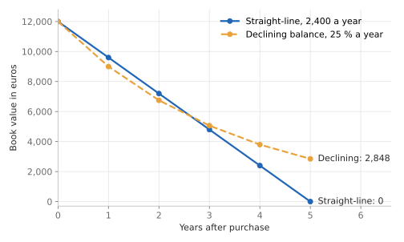

# Depreciation {#sec-depreciation}

::: {.goals}
Goals

- Explain what depreciation is and why businesses record it.
- Calculate straight-line depreciation as a linear function.
- Calculate declining-balance depreciation as an exponential function.
- Compare the two methods in a table and a graph.
:::

::: {.video minutes="9"}
Depreciation
:::

## Spreading a cost over the years

When Loop Cycles buys workshop equipment for €12,000, it does not use it up in one month. It uses it for several years. In the accounts, the cost is therefore spread over the years of use: each year, a part of the purchase price is recorded as a cost called **depreciation** (*Abschreibung*). What is left is the **book value** (*Buchwert, Restbuchwert*), the value of the equipment in the books.

You will learn the accounting side in your accounting module. Here we look at the two basic methods, which turn out to be two functions you already know.

::: {.callout-important appearance="simple"}
## A note on tax rules
For the tax return, tax law decides which method, which useful life and which rate a business may use, and these rules change from time to time. In Germany, for example, the tax office publishes tables of useful lives (*AfA-Tabellen*). This chapter is about the mathematics; always check the current rules before you use a method for taxes.
:::

## Straight-line depreciation

With **straight-line depreciation** (*lineare Abschreibung*), the same amount is written off every year. If $A_0$ is the purchase price, $R$ the expected value at the end (often 0) and $n$ the useful life in years:

$$D = \frac{A_0 - R}{n}, \qquad B_t = A_0 - D \cdot t$$

The book value $B_t$ after $t$ years is a **linear function** with slope $-D$ (Session 3).

::: {.callout-note}
## Worked example: straight-line
The equipment costs €12,000 and is used for 5 years, with no value at the end.

$$
\begin{aligned}
D &= \frac{12\,000}{5} = 2\,400 \text{ euros a year}\\
B_t &= 12\,000 - 2\,400\,t
\end{aligned}
$$

After 2 years, the book value is $12\,000 - 4\,800 = 7\,200$ euros; after 5 years it is 0.
:::

## Declining-balance depreciation

With **declining-balance depreciation** (*degressive Abschreibung*), the same **percentage** $p$ of the current book value is written off every year. Each year, the book value is multiplied by $1 - p$:

$$B_t = A_0 \cdot (1 - p)^t$$

This is an **exponential function** with a growth factor below 1, like the delivery van in @sec-exp-log. The amounts written off are large at first and get smaller every year. That often matches reality: a bike, a car or a laptop loses most of its value in the first years.

::: {.callout-note}
## Worked example: declining balance
The same equipment, written off at 25 % of the book value each year.

| Year | Book value at start | Depreciation (25 %) | Book value at end |
|:----:|-----:|-----:|-----:|
| 1 | 12,000.00 | 3,000.00 | 9,000.00 |
| 2 | 9,000.00 | 2,250.00 | 6,750.00 |
| 3 | 6,750.00 | 1,687.50 | 5,062.50 |
| 4 | 5,062.50 | 1,265.63 | 3,796.88 |
| 5 | 3,796.88 | 949.22 | 2,847.66 |

Check with the formula: $B_5 = 12\,000 \cdot 0.75^5 = 12\,000 \cdot 0.2373 \approx 2\,847.66$ euros.
:::

The book value never reaches zero, because you always take a percentage of what is left. In practice, a business can switch to straight-line depreciation for the remaining years once that gives the larger amount, so that the book value does reach zero at the end of the useful life.

{#fig-depreciation fig-alt="Two lines starting at 12,000 euros. The solid straight line falls by 2,400 euros a year to 0 after 5 years. The dashed curve falls steeply at first and then flatter, to 2,848 euros after 5 years."}

::: {.callout-warning}
## Common mistake: taking the percentage of the price every year
With declining balance, 25 % is taken of the **current book value**, not of the original price. Taking 25 % of €12,000 every year would be straight-line depreciation over 4 years.
:::

## In a spreadsheet, R and Python

```{.sheet title="Both depreciation methods side by side. Price, life and rate are inputs in B1:B3." highlight="B6 C6" header="false"}
Price | 12000 | |
Useful life | 5 | |
Declining rate | 25% | |
 | | |
Year | Straight-line | Declining balance
0 | =B1 -> 12,000.00 | =B1 -> 12,000.00
=A6+1 -> 1 | =B6-$B$1/$B$2 -> 9,600.00 | =C6*(1-$B$3) -> 9,000.00
=A7+1 -> 2 | =B7-$B$1/$B$2 -> 7,200.00 | =C7*(1-$B$3) -> 6,750.00
```

Spreadsheets also have functions for this, such as `SLN` for straight-line (German Excel: `LIA`). For declining balance, the simple formula above is clearer than the built-in functions, which follow their own conventions.

::: {.panel-tabset group="language"}
## R
```r
price <- 12000; life <- 5; rate <- 0.25
t <- 0:5
data.frame(year = t,
           straight  = price - price / life * t,
           declining = round(price * (1 - rate)^t, 2))
#   year straight declining
# 1    0    12000  12000.00
# 2    1     9600   9000.00
# ...
# 6    5        0   2847.66
```
## Python
```python
price, life, rate = 12000, 5, 0.25
for t in range(6):
    print(t, price - price / life * t, round(price * (1 - rate)**t, 2))
# 0 12000.0 12000.0
# 1 9600.0 9000.0
# ...
# 5 0.0 2847.66
```
:::

::: {.callout-tip}
## Check yourself

1. A delivery bike costs €6,000 and is used for 4 years with no value at the end. Write down the straight-line book value as a function of $t$.

   ::: {.hidden-solution}
   $D = \frac{6\,000}{4} = 1\,500$, so $B_t = 6\,000 - 1\,500\,t$.
   :::

2. A machine for €30,000 is written off at 20 % declining balance. What is its book value after 3 years?

   ::: {.hidden-solution}
   $30\,000 \cdot 0.8^3 = 30\,000 \cdot 0.512 = 15\,360$ euros.
   :::

3. For the machine in question 2, after how many years is the book value below €10,000?

   ::: {.hidden-solution}
   $0.8^t < \frac{1}{3}$, so $t > \frac{\ln(1/3)}{\ln 0.8} \approx \frac{-1.0986}{-0.2231} \approx 4.9$. After **5 years** ($30\,000 \cdot 0.8^5 \approx 9\,830.40$).
   :::
:::
